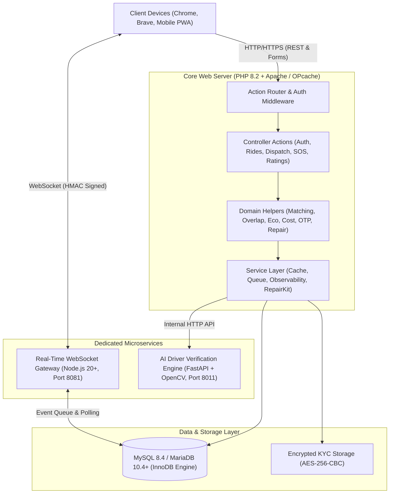

<div align="center">

# 🚗 RideSync — Campus Mobility & Carpooling Transit Platform

### Intelligent Campus Mobility, Geodesic Route Matching & Driver Dispatch Platform

[](https://github.com/shaunakjaiwant/ridesync/stargazers)
[](https://github.com/shaunakjaiwant/ridesync/releases)
[](https://github.com/shaunakjaiwant/ridesync/actions/workflows/quality.yml)
[](https://www.php.net/)
[](https://www.mysql.com/)
[](https://nodejs.org/)
[](https://fastapi.tiangolo.com/)
[](LICENSE)
[](https://ridesync-app-81i7.onrender.com/)

**RideSync is a production-grade, full-stack campus transit and carpooling platform engineered to solve last-mile commute bottlenecks across university ecosystems.**

[🌐 Live Production Demo](https://ridesync-app-81i7.onrender.com/) • [📄 Academic Report (PDF)](docs/RideSync_Report.pdf) • [📝 Academic Report (Docx)](docs/RideSync_Comprehensive_College_Project_Report.docx) • [📖 Full Report (Markdown)](docs/ACADEMIC_PROJECT_REPORT.md)

</div>

---

## 📌 Table of Contents

- [Overview](#-overview)
- [Key Engineering Highlights](#-key-engineering-highlights)
- [System Architecture](#-system-architecture)
- [Core Mathematical Models & Algorithms](#-core-mathematical-models--algorithms)
- [Live Portals & Access Points](#-live-portals--access-points)
- [Academic Project Report](#-academic-project-report)
- [Getting Started & Local Setup](#-getting-started--local-setup)
- [Dual-Browser Automated Testing](#-dual-browser-automated-testing)
- [Live Viva Voce & Exhibition Demonstration](#-live-viva-voce--exhibition-demonstration)
- [Quality Assurance & Test Suite](#-quality-assurance--test-suite)
- [Repository Structure](#-repository-structure)
- [License](#-license)

---

## 🌟 Overview

**RideSync** is an end-to-end, high-performance web-based campus mobility and intelligent driver dispatch platform. Engineered specifically to resolve last-mile commute bottlenecks, fragmented transit coordination, and transportation inefficiencies across university campuses, RideSync unites **student riders**, **campus drivers**, and **institutional administrators** into a synchronized transit network.

Unlike commercial ride-hailing services (Uber, Ola) that rely on aggressive dynamic surge pricing and unverified strangers, RideSync operates within a **verified institutional perimeter**, enforces a **transparent, fair-fare split model** with zero surge, and integrates **geodesic partial-path corridor fitting** for efficient carpooling.

---

## ⚡ Key Engineering Highlights

- **Multi-Role Responsive UI:** Unified Rider, Driver, and Admin portals featuring a floating glassmorphic mobile navigation bar, single-row sticky header, universal segmented tabs, and automatic table-to-card dynamic reflow for mobile viewports.
- **Geodesic Route Fitting:** Spherical Haversine spatial calculations, multi-factor compatibility scoring, and OSRM server-side polyline snapping with forward-directional sequencing.
- **Strict Pessimistic Concurrency Locking:** ACID-compliant database transactions utilizing `SELECT ... FOR UPDATE` row locks to eliminate double-claim race conditions under high concurrent demand.
- **Real-Time Telemetry & Safety Core:** WebSocket-based live GPS coordinate streaming, bearing calculations, dynamic ETA updates, and 1-tap emergency SOS escalation with geo-tagged alerts.
- **AI Driver KYC Verification Sandbox:** FastAPI microservice with OpenCV facial feature matching, OCR document extraction, document tampering detection, and a synthetic academic compliance sandbox.
- **Ecological Impact Quantification:** Automated $\text{CO}_2$ emissions avoidance calculations ($0.12\text{ kg CO}_2\text{/km}$), fuel conservation metrics, and campus green leaderboard tracking.
- **Autonomous Operational Self-Healing (Repair Kit):** Production Repair Kit featuring 14 automated diagnostics, missing index auto-creation, stale lock eviction, queue repair, and AES-256 encrypted run logging.
- **Dual-Browser CDP Automation Engine:** Headless end-to-end testing across Google Chrome and Brave Browser via the Chrome DevTools Protocol.
- **100% Quality Pass & Sub-50ms Latency:** 68 PHPUnit tests (243 assertions), 19 negative security tests, 6 authenticated API lifecycle flows, 27 OpenAPI contract paths, and 25 AI microservice selftests.

---

## 🏛️ System Architecture



### Technology Stack
- **Backend Application Core:** PHP 8.2 (Strict Types, MySQLi, OPcache bytecode pre-compilation)
- **Database Layer:** MySQL 8.4 / MariaDB 10.4+ (InnoDB Storage Engine, Foreign Keys, Composite Indexes)
- **Realtime Gateway:** Node.js 20+ WebSocket Gateway (`ws`, HMAC-SHA256 handshake tokens, Port 8081)
- **AI Verification Service:** Python 3.11/3.13 FastAPI + OpenCV (OCR extraction, facial cosine similarity, Port 8011)
- **Frontend & Design Tokens:** Vanilla JavaScript (ES6+), Glassmorphic CSS Design Token scale (0 framework overhead)
- **Hosting & Infrastructure:** Render Docker Web Services (PHP 8.2 Apache + OPcache) & Managed Cloud MySQL
- **Browser Automation:** Chrome DevTools Protocol (CDP) runners for Google Chrome & Brave Browser

---

## 📐 Core Mathematical Models & Algorithms

### 1. Geodesic Route Distance (Spherical Haversine)
$$\Delta\phi = \text{rad}(\phi_2 - \phi_1), \quad \Delta\lambda = \text{rad}(\lambda_2 - \lambda_1)$$
$$a = \sin^2\left(\frac{\Delta\phi}{2}\right) + \cos(\phi_1) \cdot \cos(\phi_2) \cdot \sin^2\left(\frac{\Delta\lambda}{2}\right)$$
$$c = 2 \cdot \text{atan2}\left(\sqrt{a}, \sqrt{1 - a}\right), \quad d = R \cdot c \quad (R = 6,371\text{ km})$$

### 2. Multi-Factor Route Fit Scoring
$$\text{Fit Score} = (0.50 \cdot S_{\text{dist}}) + (0.35 \cdot S_{\text{time}}) + (0.15 \cdot S_{\text{seats}})$$
Routes scoring below $0.60$ are automatically routed to on-demand driver dispatch.

### 3. Dynamic Fair-Fare Split (`km_rate_v3_fair_split`)
- Base rate: ₹25.60/km | Delay rate: ₹1.25/minute
$$\text{Final Fare Per Person} = \left\lceil \frac{\text{Base Route Fare}}{N} \right\rceil + \left\lceil \frac{\text{Detour Cost}}{N} \right\rceil + \left\lceil \frac{\text{Time Cost}}{N} \right\rceil$$

### 4. Ecological Impact Model
$$\text{Avoided CO}_2\text{ (kg)} = (N_{\text{riders}} - 1) \times \text{Distance (km)} \times 0.12\text{ kg CO}_2\text{/km}$$
$$\text{Trees Equivalent} = \frac{\text{Avoided CO}_2\text{ (kg)}}{22.0}$$

---

## 🌐 Live Portals & Access Points

The live production application is deployed on Render Cloud:

| Portal | Public URL | Description |
| :--- | :--- | :--- |
| **Rider Portal / Landing** | [https://ridesync-app-81i7.onrender.com/](https://ridesync-app-81i7.onrender.com/) | Carpool discovery, trip posting, and live GPS tracking |
| **Driver Portal** | [https://ridesync-app-81i7.onrender.com/ridesync/pages/driver_login.php](https://ridesync-app-81i7.onrender.com/ridesync/pages/driver_login.php) | Driver onboarding, KYC review, and dispatch request claim |
| **Admin Operations** | [https://ridesync-app-81i7.onrender.com/ridesync/pages/admin_login.php](https://ridesync-app-81i7.onrender.com/ridesync/pages/admin_login.php) | Operational dashboard, verification queue, and Repair Kit |
| **Service Health Probe** | [https://ridesync-app-81i7.onrender.com/ridesync/health.php](https://ridesync-app-81i7.onrender.com/ridesync/health.php) | JSON service liveness and database connectivity probe |

---

## 📑 Academic Project Report

The complete, formal **Computer Science & Engineering Major Project Report** is available in multiple formats:

- **📄 Official Evaluation PDF:** [docs/RideSync_Report.pdf](docs/RideSync_Report.pdf)
- **📝 Formatted Word Document (.docx):** [docs/RideSync_Comprehensive_College_Project_Report.docx](docs/RideSync_Comprehensive_College_Project_Report.docx)
- **📖 Comprehensive Markdown Report:** [docs/ACADEMIC_PROJECT_REPORT.md](docs/ACADEMIC_PROJECT_REPORT.md)

To regenerate the Word and PDF reports from source at any time:
```powershell
python tools/generate_college_report.py
```

---

## 🚀 Getting Started & Local Setup

### Prerequisites
- **PHP 8.2+** with `mysqli`, `openssl`, `fileinfo`, `curl` extensions
- **MySQL 8.0+** or **MariaDB 10.4+**
- **Node.js 20+** & npm
- **Python 3.11+** (for AI verification microservice)

### Installation

1. **Clone the repository:**
   ```bash
   git clone https://github.com/shaunakjaiwant/ridesync.git
   cd ridesync
   ```

2. **Configure environment:**
   ```bash
   cp .env.example .env
   # Edit .env with your local MySQL credentials
   ```

3. **Install dependencies:**
   ```bash
   composer install
   npm install
   ```

4. **Initialize database schema & demo seed:**
   ```bash
   php tools/db_bootstrap_check.php
   php tools/seed_demo_data.php
   ```

5. **Start services:**
   - **Apache/PHP:** Point document root to `c:\xampp\htdocs\` or use `php -S 127.0.0.1:8000`
   - **WebSocket Gateway:** `npm run ws:gateway` (runs on port 8081)
   - **AI Verification Service:** `python apps/ai-verification/app/main.py` (runs on port 8011)

---

## 🧪 Dual-Browser Automated Testing

RideSync features automated browser test runners that communicate directly with Google Chrome and Brave Browser via the Chrome DevTools Protocol (CDP):

```bash
# Auto-detect and run cross-browser test suite
npm run test:browser

# Run specifically against Google Chrome
npm run test:chrome

# Run specifically against Brave Browser (validates Brave Shields & ad-blocker compatibility)
npm run test:brave

# Launch interactive browser sessions for live demonstration:
npm run chrome:open
npm run brave:open
```

---

## 🎭 Live Viva Voce & Exhibition Demonstration

To showcase RideSync during project evaluations and exhibitions:

1. **Seed Demo Environment (Non-Destructive):**
   ```bash
   npm run seed:demo
   ```
2. **Execute Full Quality Verification Gate:**
   ```bash
   npm test
   ```
3. **Launch Dual Browsers Side-by-Side:**
   ```bash
   npm run chrome:open
   npm run brave:open
   ```
4. **Demonstrate Real-Time Flow:**
   - **Rider:** Post a ride or request a campus commute.
   - **Driver:** Claim the incoming dispatch request under pessimistic concurrency lock (`SELECT ... FOR UPDATE`).
   - **Safety:** Trigger 1-tap SOS and view real-time WebSocket broadcast to admin monitoring console.
   - **AI Sandbox:** Upload KYC documents and inspect OCR text extraction and facial matching score.
   - **Self-Healing:** In Admin Dashboard, execute "Run Deep Scan" via the Repair Kit.

---

## 📊 Quality Assurance & Test Suite

RideSync enforces a multi-tiered testing pipeline with 100% pass rates:

| Testing Suite | Framework | Scope / Coverage | Status |
| :--- | :--- | :--- | :--- |
| **PHPUnit Suite** | PHPUnit 11.5 | 68 unit & integration tests, 243 assertions | **100% PASS** |
| **Negative API Security** | PHP CLI Harness | 19 negative boundary & authentication tests | **100% PASS** |
| **Authenticated API Workflows** | PHP Session Harness | 6 end-to-end authenticated API lifecycle checks | **100% PASS** |
| **OpenAPI Contract Validation** | OpenAPI 3.0 | 27 API paths validated against schema | **100% PASS** |
| **Regression Integrity** | PHP Test Harness | 3 regression suites (Status, Principal, Security) | **100% PASS** |
| **AI Microservice Selftest** | FastAPI / Pytest | 25 internal health, OCR, and facial model checks | **100% PASS** |
| **High Concurrency Profiling** | K6 Load Runner | Sub-50ms TTFB p95 latency under concurrent load | **TARGET MET** |

Run the entire quality gate with a single command:
```bash
npm test
```

---

## 📁 Repository Structure

```
ridesync/
├── actions/                  # 27 modular controller actions (Auth, Rides, Dispatch, SOS, Ratings)
├── apps/
│   └── ai-verification/      # FastAPI + OpenCV driver KYC verification microservice
├── api/                      # RESTful endpoints (v1 health, readiness, tokens, telemetry)
├── assets/                   # Public media assets and iconography
├── config/                   # Configuration loaders and database connection managers
├── css/                      # Design token system and glassmorphic styling sheets
├── database/                 # Production schema.sql, baseline seeds, and 14 migration files
├── docs/                     # Academic reports (.pdf, .docx, .md) and architecture documentation
├── includes/                 # Domain helpers (Matching, Overlap, Eco, Cost, OTP, Repair Kit)
├── js/                       # Vanilla ES6+ client interactions and Leaflet map rendering
├── pages/                    # Multi-role views (Rider, Driver, and Admin panels)
├── realtime/
│   └── websocket-gateway/    # Node.js real-time WebSocket telemetry gateway (Port 8081)
├── tests/                    # PHPUnit tests, API security tests, and K6 load scenarios
├── tools/                    # Operational utilities, Repair Kit, CDP browser runners, and report generator
├── Dockerfile                # Multi-stage production container build
└── render.yaml               # Render Cloud Blueprint infrastructure configuration
```

---

## 📜 License

This project is licensed under the [MIT License](LICENSE) - open for academic evaluation, research, and non-commercial collegiate transit use.

---

<div align="center">
  <b>Developed by Shaunak Jaiwant</b><br>
  <i>Department of Computer Science & Engineering</i><br>
  RideSync &copy; 2026. All rights reserved.
</div>
